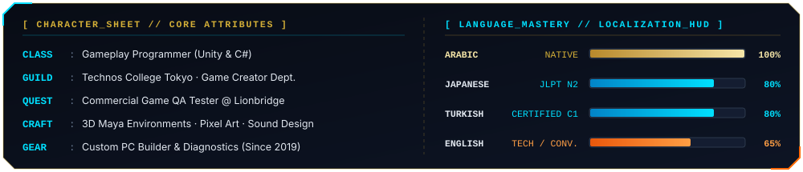

 

  

  

### ✦ PLAYER DOSSIER · نبذة عني

A Syrian student and aspiring **Game Programmer** based in **Tokyo, Japan**. Currently studying in the **Game Creator Department** at **Technos College Tokyo Institute of Technology (東京工学院専門学校)** *(April 2026 – Present)* focusing on **Unity & C#** gameplay programming, while working as an invitation-based part-time **Game Tester (QA)** at **Lionbridge** *(May 2026 – Present)*.

I blend core gameplay programming (`Unity`, `C#`), 3D environment modeling (`Autodesk Maya`), pixel art & UI design (`Photoshop`), and sound design (`Cubase`) with modern AI build tools to turn my own original game concepts and creative direction into working code, layouts, and structured **Game Design Documents (GDDs)**.

  

* 🤝 **Co-Op & Team Spirit:** Known for breaking down complex technical topics from the ground up and mentoring Japanese classmates at vocational school.
* 🚀 **Lore & Off-Duty:** Avid builder of **Macross** mecha plastic model kits, and an 11-year **Warframe** veteran who met the **Digital Extremes** development team in person at **Tokyo Game Show 2024**.
* 🎯 **Current Objective:** Seeking **Game Programming internships or junior roles** (on-site in Tokyo or remote).

  

### ✦ QUEST LOG 01 // GAME DESIGN DOCUMENTS (GDDs), INTERACTIVE GUIDES & 3D/2D WORKS

| Work | Category & Stack | Scope & Creative Highlights | Access |
| :--- | :--- | :--- | :---: |
| **Echoes of Damascus (ダマスカスの残響 / أصداء دمشق)** | `Game Design Document (GDD)` `2D Platformer` `AR / EN / JA / KO / TR` | Original lyrical 2D platformer proposal and GDD featuring story direction, gameplay mechanics, puzzle flows, and full multi-language support. |  |
| **Barjees (البرجيس / バルジース)** | `Game Design Document (GDD)` `Board Game` `Syrian Heritage` | Complete GDD modernizing the traditional Syrian cross-track board game Barjees, detailing rules adaptation, shell probability systems, and digital balance. |  |
| **Sol Frame — System & Game Design Spec** | `Technical GDD` `34 Sections` `5-Language Sync` | Comprehensive 34-section game and systems design specification covering wave architecture, weapon progression, enemy patterns, and timing tables. |  |
| **Warframe 101** | `Interactive Web Guide` `Vanilla HTML5 / CSS3 / JS` `Trilingual` | Multilingual interactive beginner's guide to Warframe built from scratch without frameworks, featuring interactive system widgets and responsive navigation. |  |
| **3D Environments (Musashi-Koganei & Technos Campus)** | `Autodesk Maya` `3D Modeling` `Texturing & Lighting` | Full-scale 3D reconstruction of Musashi-Koganei Station and the Technos College Tokyo campus modeled, textured, and lit from first-hand photo reference (8 renders). |  |
| **Pixel Art, Character Sprites & UI Design** | `Adobe Photoshop` `LibreSprite` `2D Game Art & UI/UX` | Character sprite sheets, 8-bit silhouettes, controller action maps, UI/UX mockups, and graphic design studies. |  |

  

### ✦ QUEST LOG 02 // ADDITIONAL TECH SYSTEMS (WEB & MOBILE APPS)
> *Note: Production repositories are kept private for security and infrastructure protection. Live Cloudflare Pages deployments are linked below.*

| Application | Stack | Overview | Live Deployment |
| :--- | :--- | :--- | :---: |
| **レシート帳 (Receipt & Invoice Tracker)** | `Flutter` `Dart` `Cloudflare Workers` `Firebase` `Gemini API` | Cross-platform Japanese receipt & qualified-invoice (`登録番号`) tracker with dual 1D barcode scanning and AI extraction + on-device OCR fallback. |  |
| **One Day Leader (日直管理システム)** | `JavaScript (ES6+)` `Firebase Auth` `Cloud Firestore` `Cloudflare Pages` | Real-time classroom rotation and attendance PWA with dynamic active-pool rotation and Japanese national holiday synchronization (`holidays-jp`). |  |
| **Cycle Companion** | `TypeScript` `Vite` `Tailwind CSS` `Firestore Rules` | Privacy-first educational companion web app with strict document-level database partitioning, atomic invite transactions, and i18n parity auditing. |  |
| **ContentGuard (Android 16)** | `Kotlin` `Jetpack Compose` `Accessibility API` `DataStore` | 100% offline, zero-permission (`no INTERNET`) digital habit controller for Android 16 (API 36) using multi-signal node hierarchy detection. | `Private Source` |

  

### ✦ TECH LOADOUT & GAME DEV ARSENAL

| Loadout Category | Equipped Technologies & Specializations |
| :--- | :--- |
| **Core Game Dev** | `Unity` · `C#` · `Gameplay Programming` · `Game Design Documents (GDD)` · `Level & System Design` |
| **3D, 2D Art & Audio** | `Autodesk Maya` *(3D Modeling, Texturing, Lighting)* · `Blender` · `Adobe Photoshop` *(Pixel Art, UI/UX)* · `Steinberg Cubase` *(Sound Design)* |
| **Web, Mobile & Cloud** | `HTML5` · `CSS3` · `JavaScript` · `TypeScript` · `Flutter / Dart` · `Kotlin` · `Firebase` · `Cloudflare Pages` · `Git & GitHub` · `AI Build Tools` |
| **Hardware & QA Rig** | `Commercial QA & Bug Reporting (Jira)` · `PC Assembly, Teardown & Upgrades (since 2019)` · `Hardware & Software Diagnostics (since 2014)` |

  

### ✦ EXPERIENCE & GUILD HISTORY

* 🎮 **Game Tester (QA)** — **Lion Bridge** *(May 2026 – Present · Invitation-based part-time, Tokyo)*
* 🏛️ **Game Programming (Unity & C#)** — **Technos College Tokyo Institute of Technology (東京工学院専門学校)** *(April 2026 – Present)*
* 🇯🇵 **Japanese Language Dept.** — **Japan Institute of Technology College** *(Graduated March 2024 · JLPT N2 & N3 Certified)*
* 🇹🇷 **Dept. of Turkish** — **ÇOMÜ University, Turkey** *(Graduated May 2018 · Level C1 Certified)*

  

### ✦ TERMINAL // CONTACT & MULTILINGUAL RESUMES

📄 **Download CV (PDF):** [English](https://my-portfolio-ep5.pages.dev/Resume_English.pdf) · [日本語](https://my-portfolio-ep5.pages.dev/Resume_Japanese.pdf) · [العربية](https://my-portfolio-ep5.pages.dev/Resume_Arabic.pdf) · [Türkçe](https://my-portfolio-ep5.pages.dev/Resume_Turkish.pdf) · [한국어](https://my-portfolio-ep5.pages.dev/Resume_Korean.pdf)

